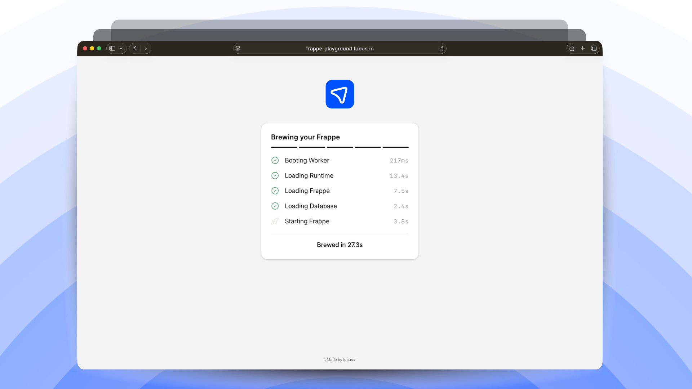

<p align="center"></p>



[![Launch Playground](https://img.shields.io/badge/Launch%20Playground-3858e9?style=for-the-badge&logo=&logoSize=auto)](https://frappe-playground.lubus.in)

# Frappe Playground

Run Frappe Framework entirely in the browser with Pyodide and WebAssembly. Frappe Playground provides persistent browser-local sites, optional apps, and a static deployment that does not require a Python application server.

> [!CAUTION]
> Frappe Playground is under active development.

## Documentation

Read the [Frappe Playground documentation](https://frappe-playground.lubus.in/docs/) for:

- [using the playground](https://frappe-playground.lubus.in/docs/guide/getting-started)
- [boot flags](https://frappe-playground.lubus.in/docs/guide/boot-flags)
- [self-hosting and deployment](https://frappe-playground.lubus.in/docs/hosting/)
- [customization](https://frappe-playground.lubus.in/docs/hosting/customize)
- [architecture and inner workings](https://frappe-playground.lubus.in/docs/architecture/)
- [contributor setup and testing](https://frappe-playground.lubus.in/docs/development/)

## Local development

Docker is required to prepare the Frappe runtime on a clean checkout.

```bash
git clone https://github.com/lubusIN/frappe-playground.git
cd frappe-playground
npm install
npm run build:runtime
npm run dev
```

Open `http://localhost:5173/`. Existing runtime artifacts can be reused for client-only development.

## Common commands

| Command | Purpose |
| --- | --- |
| `npm run dev` | Start the playground development server |
| `npm run docs:dev` | Start the documentation development server |
| `npm run docs:screenshots` | Regenerate documentation screenshots |
| `npm run build` | Build the playground and documentation into `dist/` |
| `npm run test:contract` | Run the fast contract suite |
| `npm test` | Run contract, clean-build, and browser tests |
| `npm run predeploy` | Prepare and verify the Cloudflare Pages output |

See the [contributor guide](https://frappe-playground.lubus.in/docs/development/) for prerequisites, repository structure, build behavior, and focused test commands.

## Inspiration

Frappe Playground is inspired by the foundational work of the [WordPress Playground](https://github.com/WordPress/wordpress-playground) team in bringing full-stack applications into the browser through WebAssembly.

## More Frappe Tools

Explore more open-source tools we're building for the Frappe ecosystem.

<table>
  <tr>
    <td width="50%" valign="top">
      <a href="https://github.com/lubusIN/frappe-local">
        
      </a>
      <br>
      Manage Frappe benches and sites visually.
    </td>
    <td width="50%" valign="top">
      <a href="https://github.com/lubusIN/frappe-brewery">
        
      </a>
      <br>
      An open app registry for the Frappe Apps.
    </td>
  </tr>

  <tr>
    <td width="50%" valign="top">
      <a href="https://github.com/lubusIN/frappe-vault">
        
      </a>
      <br>
      Manage secrets and passwords with Frappe.
    </td>
    <td width="50%" valign="top">
      <a href="https://github.com/lubusIN/wp-frappe-data-store">
        
      </a>
      <br>
      React Data store for WordPress.
    </td>
  </tr>
</table>

[Explore all LUBUS projects →](https://github.com/lubusIN)

## Meet Your Artisans

[LUBUS](https://lubus.in/?utm_source=github&utm_medium=open-source&utm_campaign=frappe-playground) is a web design agency based in Mumbai.

<a href="https://cal.com/lubus">

</a>

## License

Frappe Playground is open-sourced licensed under the [MIT License](LICENSE).
